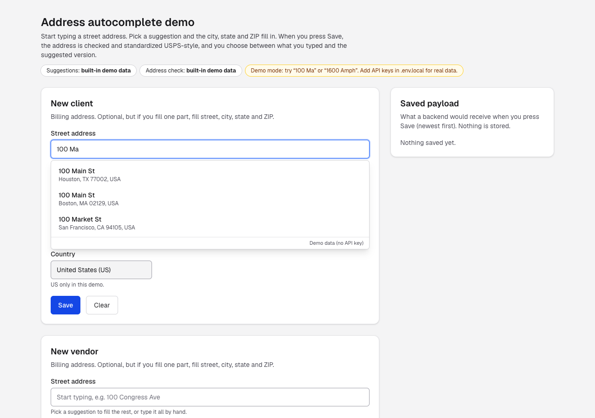
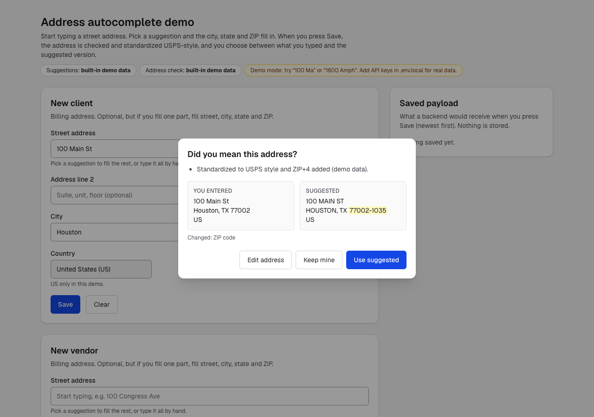

# Address autocomplete demo

Type a street address, pick a suggestion, and the city, state and ZIP fill in by themselves. When you press **Save**, the address is checked and standardized the USPS way (for example `100 congress avenue` becomes `100 CONGRESS AVE` and the ZIP+4 is added), and you choose between what you typed and the suggested version.

It works **without any API keys** using built-in demo data. Add keys to use real Google or USPS data.

| Suggestions while typing | "Did you mean…?" on Save |
|---|---|
|  |  |

## What it shows

1. **Suggestions as you type.** After 3 characters the street box shows up to 5 addresses. Picking one fills Street, City, State and ZIP. You can always ignore the suggestions and type by hand.
2. **Clean fields.** State is a dropdown of 2-letter US codes (no "Texas state" typos), and the ZIP must be `12345` or `12345-6789`. An address is optional, but if you fill one part you must fill street, city, state and ZIP.
3. **Check on Save.** The address is sent to a validation service. If the standardized version differs, a dialog shows both with the changes highlighted: **Use suggested**, **Keep mine**, or **Edit address**. If the address can't be found, you can still **Save anyway**. If the service is down, you can save without checking.
4. **Saved payload.** The panel on the right shows exactly what a backend would receive.

## Run it

Needs Node.js 20.9 or newer (tested on 22).

```bash
git clone https://github.com/VKRISH1116/address-autocomplete-demo.git
cd address-autocomplete-demo
npm install
npm run dev
```

Open http://localhost:3000 and type `100 Ma` or `1600 Amph` in a Street box.

## Modes and keys

Copy `.env.example` to `.env.local`, fill in what you have, and restart `npm run dev`.

| Setting | Suggestions | Check on Save | Needs |
|---|---|---|---|
| nothing set (default) | demo data | demo data | nothing |
| `ADDRESS_PROVIDER=google` | Google Places | Google Address Validation (USPS CASS) | `GOOGLE_MAPS_API_KEY` |
| `ADDRESS_PROVIDER=google` + `VALIDATOR=usps` | Google Places | USPS Addresses API v3 | Google key + USPS client ID/secret |
| `ADDRESS_PROVIDER=mock` + `VALIDATOR=usps` | demo data | USPS Addresses API v3 | USPS client ID/secret |

### Getting a Google key
1. In the [Google Cloud console](https://console.cloud.google.com/), create a project and turn on billing (there is a free monthly allowance).
2. Enable **Places API (New)** and **Address Validation API**.
3. APIs & Services → Credentials → **Create API key**, then restrict it to those two APIs.
4. No credit card? Google's [Maps Demo Key](https://developers.google.com/maps/demo-key) covers Places for prototyping (not Address Validation).

### Getting USPS access (free)
1. Create an account at the [USPS developer portal](https://developers.usps.com).
2. Create an app and copy its **Consumer Key** (client ID) and **Consumer Secret**.
3. Put them in `USPS_CLIENT_ID` / `USPS_CLIENT_SECRET`.

### Cost notes
- Google Autocomplete requests are billed as one **session** when they end with a Place Details call using the same session token, which this demo does. Abandoned searches are billed per request.
- Google Address Validation is billed per call after the free monthly allowance (check the current [pricing](https://mapsplatform.google.com/pricing/)).
- The USPS API is free but rate-limited.

## How it works

```
Browser (React)                         Next.js server (keys live here)             Services
──────────────────                       ─────────────────────────────              ─────────────────
AddressAutocomplete ─ GET /api/address/autocomplete?q=&session= ─► provider.autocomplete ─► Google Places (New) / demo data
   pick a row       ─ GET /api/address/details?id=&session=   ─► provider.details      ─► Place Details (address parts)
AddressForm Save    ─ POST /api/address/validate {address}     ─► validator.validate    ─► Address Validation / USPS v3 / demo
```

- **Keys never reach the browser.** The browser only calls this app's own `/api/address/*` routes; those routes call Google or USPS from the server.
- `lib/address.ts` holds the six-field address shape, the state list, the ZIP check and `mapGoogleComponents()`, which turns Google's address parts into fields:

| Google part | Field |
|---|---|
| `street_number` + `route` | Street |
| `subpremise` | Address line 2 |
| `locality` (or `postal_town` / `sublocality`) | City |
| `administrative_area_level_1` (short) | State |
| `postal_code` (+ `postal_code_suffix`) | ZIP (ZIP+4) |
| `country` (short) | Country |

- `lib/providers/` has one file per service (`mock.ts`, `google.ts`, `usps.ts`), so swapping vendors means adding one file.
- UI is built with [React Aria Components](https://react-spectrum.adobe.com/react-aria/) for keyboard and screen-reader support: arrow keys move through suggestions, Enter picks, Esc closes.

## Project layout

```
app/
  page.tsx                         demo page (two forms + payload panel)
  api/address/autocomplete/route.ts
  api/address/details/route.ts
  api/address/validate/route.ts
components/
  AddressAutocomplete.tsx          street box with live suggestions
  AddressForm.tsx                  six fields, checks, "Did you mean…?" dialog
  Demo.tsx
lib/
  address.ts                       shape, states, ZIP rule, Google mapping
  http.ts                          JSON error helpers
  providers/                       mock, google, usps + chooser
```

## Status

- Demo mode is fully working and tested (typing, picking, errors, Did-you-mean, keyboard, phone width).
- The Google and USPS adapters follow the official API docs but have **not yet been tested with real keys**.

Built with Next.js, React 19, Tailwind CSS and React Aria Components.
